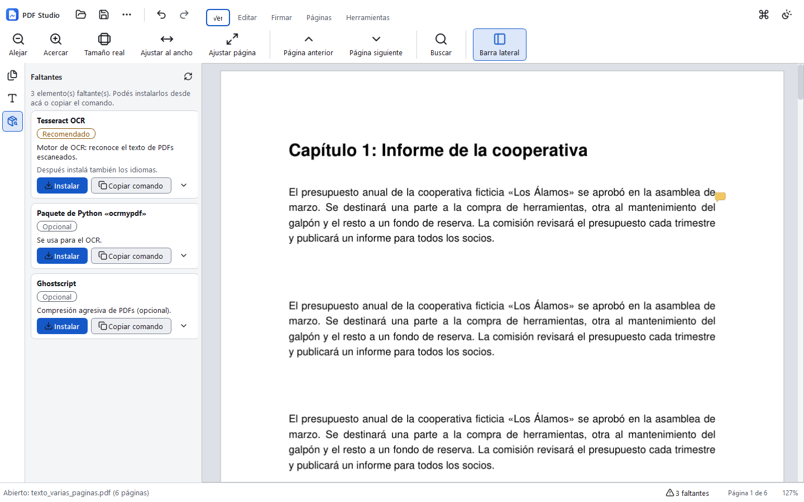

# PDF Studio

Editor de PDF para Windows, **libre y gratuito** (licencia AGPL-3.0). Todo se hace en tu
computadora: los documentos no se suben a ningún lado.



## Qué hace

- **Ver y buscar**: zoom, miniaturas, búsqueda, resaltado y notas. Tema claro, oscuro o según Windows.
- **Editar y mover texto** con la misma fuente. Si la fuente embebida está recortada, se usa la del sistema; si no está, se ofrece instalarla o reemplazarla.
- **Reemplazar una fuente en todo el documento** (modo armónico): se priorizan las métricamente compatibles, así no se corren las líneas.
- **Firmas en imagen**: una biblioteca de firmas con «Quitar fondo».
- **Firma digital con certificado** (.pfx / .p12), visible o invisible, y **validación** de las firmas de un PDF. Incluye un certificado de prueba para practicar.
- **OCR**:
  - modo «Idéntico», que agrega una capa de texto invisible y deja el aspecto igual;
  - modo «Reconstruido», experimental.
- **Convertir un escaneado a Word editable**: títulos, listas, tablas, encabezado y pie. Los logos, las firmas y los sellos se recortan como imágenes. Una revisión marca las palabras dudosas.
- **Páginas**: unir, separar, rotar, reordenar e insertar.
- **Comprimir**, **marca de agua** y **numeración**.
- **Redacción real**: borra los datos del archivo, no solo los tapa.
- **Formularios** y **comparar versiones**, con un informe en PDF.
- **Procesar por lotes** todos los PDFs de una carpeta: OCR, compresión, marca de agua, numeración o conversión a Word, con un registro.

### Principios

- **El original nunca se modifica.** Siempre se guarda una copia nueva.
- **Fidelidad verificable.** Después de cada guardado se compara el aspecto de las páginas que no se editaron contra el original, y la diferencia de píxeles tiene que ser 0. Si no lo es, se avisa antes de guardar.
- **Nunca falla en silencio.** Si falta algo (una fuente, Tesseract, un paquete), el panel **Faltantes** dice qué es y da el comando listo para copiar. También ofrece instalarlo, siempre después de pedirte confirmación.

## Instalación (para usar la app)

1. Descargá `PDFStudio-<versión>-windows.zip` y descomprimilo completo.
2. Hacé doble clic en **`Instalar.cmd`**. No pide permisos de administrador. El instalador:
   - copia la app a `%LOCALAPPDATA%\Programs\PDF Studio`;
   - crea los accesos directos en el menú Inicio y en el escritorio;
   - agrega PDF Studio a «Abrir con» para los PDF, sin cambiar tu programa predeterminado.
3. Abrí **PDF Studio** desde el menú Inicio.

Si no querés instalarla, también funciona sin instalar: abrí `PDFStudio\PDFStudio.exe` desde la carpeta descomprimida.

Si Windows muestra «Windows protegió su PC», es porque el ejecutable no está firmado por una empresa. Hacé clic en *Más información → Ejecutar de todas formas*.

**Para desinstalar:** *Configuración → Aplicaciones → PDF Studio → Desinstalar*. Las firmas que guardaste quedan en `%APPDATA%\PDFStudio`.

### Herramientas opcionales

PDF Studio avisa cuando falta alguna. Desde el panel *Faltantes* se instalan con un botón o con el comando de PowerShell que muestra:

| Para qué | Qué | Comando |
|---|---|---|
| OCR y «A Word editable» | Tesseract con español | `winget install --id tesseract-ocr.tesseract -e`. El idioma español (`spa.traineddata`) se descarga desde el panel *Faltantes*. |
| Compresión «alta» | Ghostscript | Instalador oficial, desde el panel *Faltantes*. |

## Desarrollo

Requiere Python 3.13. Usá siempre el entorno virtual del proyecto:

```powershell
cd C:\Proyectos\pdf-studio
python -m venv .venv
.\.venv\Scripts\Activate.ps1          # si PowerShell lo bloquea: Set-ExecutionPolicy -Scope CurrentUser RemoteSigned
python -m pip install -r requirements.txt
python -m pdf_studio.app               # abre la app
```

Pruebas:

```powershell
python -m pytest                                   # pruebas automáticas
python tests\robustez_pdfs_reales.py C:\mis-pdfs   # robustez con PDFs reales
```

El script de robustez usa copias temporales de los PDFs, y su informe muestra solo el nombre del archivo, la prueba y el tipo de error, nunca el contenido.

### Armar el .exe para compartir

```powershell
python -m pip install -r requirements-empaquetado.txt
python herramientas\empaquetar.py
```

El script:
- arma la carpeta `dist\PDF Studio\` con PyInstaller, en modo carpeta (*onedir*);
- corre la autoprueba del `.exe` (`PDFStudio.exe --autoprueba resultado.json`), que revisa los recursos, el guardado con fidelidad, las tareas en otro proceso, el corrector, Word, la firma digital y OpenCV;
- genera `dist\PDFStudio-<versión>-windows.zip`, que lleva el instalador, la licencia y `LICENCIAS-TERCEROS.txt`.

Si querés solo la carpeta, sin el ZIP, agregá `--sin-zip`.

### Estructura

```
pdf_studio/
  app.py              punto de entrada (también los procesos auxiliares: --tarea, --ocrmypdf, --autoprueba)
  core/               lógica sin interfaz: documento, texto, fuentes, OCR, conversión, firma digital, lotes…
  ui/                 ventana, cinta, visor, diálogos (PySide6)
  dependencias/       detector de faltantes e instalación asistida
  recursos/           íconos Lucide, fuentes libres, diccionarios, logo
instalador/           instalar.ps1, desinstalar.ps1, Instalar.cmd
herramientas/         empaquetar.py, generar_iconos_app.py, catálogo de Google Fonts
tests/                pruebas (pytest) y PDFs de ejemplo sin datos reales
```

## Licencia

PDF Studio es software libre bajo la **GNU AGPL-3.0** (ver [LICENSE](LICENSE)). Usa, entre otros:
- PyMuPDF (AGPL-3.0), PySide6 (LGPL-3.0), pikepdf (MPL-2.0), ocrmypdf (MPL-2.0), pyHanko (MIT), python-docx (MIT), OpenCV (Apache-2.0) y spylls (MPL-2.0);
- los íconos Lucide (ISC);
- las fuentes Liberation, Carlito y Caladea (SIL OFL);
- los diccionarios RLA-ES y SCOWL.

El ZIP incluye la lista completa en `LICENCIAS-TERCEROS.txt`.
